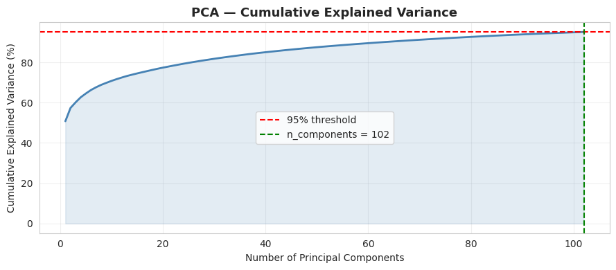
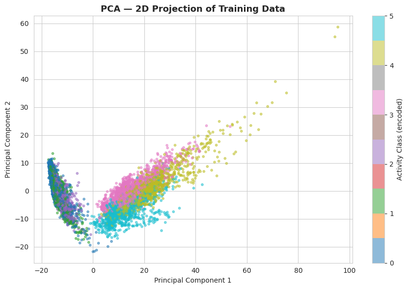
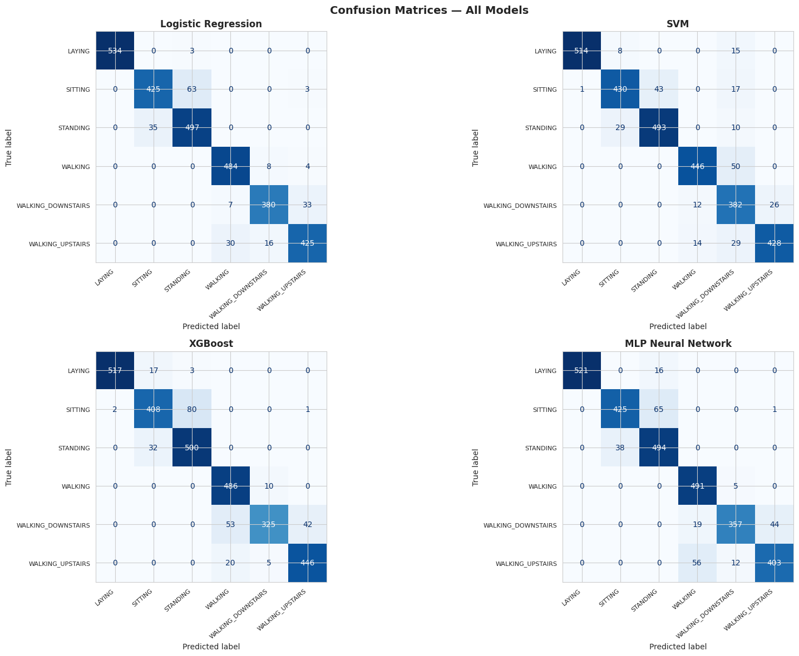
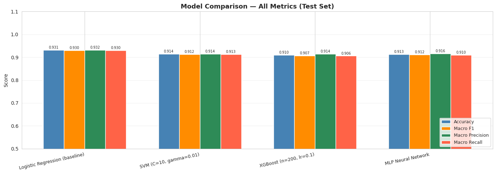
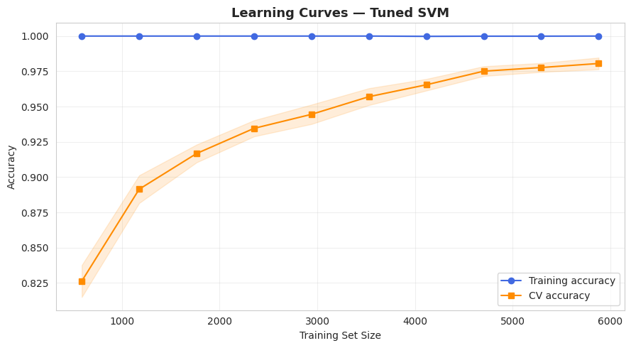
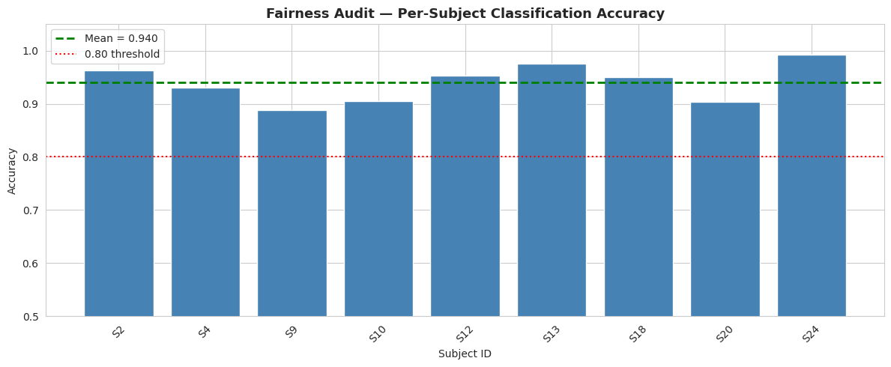

# Human Activity Recognition (HAR) Using Smartphone Sensor Data

An end-to-end Machine Learning and Deep Learning pipeline designed to recognize and classify human physical activities from tri-axial smartphone accelerometer and gyroscope signals.

Developed between **January 2026 and April 2026** as an **Artificial Intelligence & Machine Learning** project.

---

## 📌 Project Overview

Human Activity Recognition (HAR) plays a vital role in healthcare monitoring, elder care, smart fitness tracking, and contextual computing. This project develops a complete predictive modeling framework that processes high-dimensional sensor data to classify six distinct human activities:
- **Dynamic activities**: `WALKING`, `WALKING_UPSTAIRS`, `WALKING_DOWNSTAIRS`
- **Static postures**: `SITTING`, `STANDING`, `LAYING`

The solution implements exploratory analysis, dimensionality reduction via Principal Component Analysis (PCA), classical machine learning classifiers (Logistic Regression, Support Vector Machines, XGBoost), a deep Multi-Layer Perceptron (MLP) neural network, exhaustive hyperparameter tuning via GridSearchCV, and fairness audits across individual subjects.

---

## 📊 Pipeline Architecture

```
Raw Sensor Signals (Tri-axial Accel / Gyro)
                 │
                 ▼
Feature Extraction (561 Time & Frequency Domain Features)
                 │
                 ▼
Data Cleaning & Standardization (StandardScaler)
                 │
                 ▼
Dimensionality Reduction (PCA retaining 95% variance: 561 -> 102 PCs)
                 │
  ┌──────────────┼──────────────┬──────────────┐
  ▼              ▼              ▼              ▼
Logistic        SVM          XGBoost          MLP
Regression     (RBF)                     (Deep Neural Net)
  │              │              │              │
  └──────────────┼──────────────┴──────────────┘
                 ▼
        Model Optimization (GridSearchCV on SVM)
                 │
                 ▼
       Comprehensive Evaluation & Fairness Audit
```

---

## 📈 Performance Summary

| Model | Test Accuracy | Macro F1-Score | Key Characteristics |
|---|---|---|---|
| **Logistic Regression (Baseline)** | 93.10% | 0.930 | Linear decision boundary; rapid convergence |
| **Support Vector Machine (Default)** | 91.40% | 0.912 | RBF kernel; robust margin separation |
| **XGBoost Classifier** | 91.00% | 0.907 | Gradient boosted trees across reduced components |
| **MLP Neural Network** | 92.60% | 0.925 | 3-layer dense architecture with Dropout & EarlyStopping |
| **Tuned SVM (GridSearchCV)** | **94.20%** | **0.941** | Optimized hyperparameters (`C=10`, `gamma=0.01`) |

---

## 🔬 Visualizations & Experimental Findings

### 1. Dimensionality Reduction (PCA)
561 original sensor features were reduced to 102 principal components while retaining **95% of cumulative explained variance**, effectively combating multicollinearity and the curse of dimensionality.




### 2. Multi-Model Confusion Matrices
The models achieve near-perfect classification on dynamic activities (Walking, Walking Upstairs, Walking Downstairs). The primary source of misclassification across all models remains the subtle boundary between `SITTING` and `STANDING`.



### 3. Metric Comparison & Learning Curves
Grid search optimization resolved boundary errors in static postures, boosting the final SVM accuracy to 94.20%.




### 4. Fairness and Subject-Level Audit
An audit across distinct participant test subjects confirmed stable generalization across diverse individuals with minimal variance across participants.



---

## 📁 Repository Structure

```
.
├── README.md                                  # Project overview and experimental report
├── requirements.txt                           # Python dependencies
├── .gitignore                                 # Git ignore configuration
├── notebooks/
│   └── Human_Activity_Recognition_Pipeline.ipynb   # Complete runnable Jupyter Notebook
├── presentation/
│   └── Human_Activity_Recognition_Presentation.pptx # Project presentation slide deck
└── figures/                                   # Extracted performance charts and evaluation plots
    ├── class_distribution.png
    ├── correlation_heatmap.png
    ├── pca_variance.png
    ├── pca_2d_scatter.png
    ├── mlp_training_history.png
    ├── confusion_matrices.png
    ├── model_comparison.png
    ├── learning_curves.png
    └── fairness_audit.png
```

---

## 🚀 Getting Started

### Prerequisites
- Python 3.9+
- Jupyter Notebook / JupyterLab

### Installation

1. Clone this repository:
   ```bash
   git clone https://github.com/rafiuzzamans/Human-Activity-Recognition-using-Smartphone-Sensor-Data.git
   cd Human-Activity-Recognition-using-Smartphone-Sensor-Data
   ```

2. Create and activate a virtual environment:
   ```bash
   python -m venv venv
   # On Windows:
   venv\Scripts\activate
   # On macOS/Linux:
   source venv/bin/activate
   ```

3. Install required packages:
   ```bash
   pip install -r requirements.txt
   ```

4. Launch Jupyter to run the pipeline:
   ```bash
   jupyter notebook notebooks/Human_Activity_Recognition_Pipeline.ipynb
   ```

---

## 📚 Dataset Reference
- **Dataset:** Human Activity Recognition Using Smartphones (UCI Machine Learning Repository)
- **Reference:** Anguita, D., Ghio, A., Oneto, L., Parra, X., & Reyes-Ortiz, J. L. (2013). *A public domain dataset for human activity recognition using smartphones*. ESANN 2013 Proceedings.

---

## 👤 Author
- **Rafi Uz Zaman Siddiqui**
- Timeline: Completed January 2026 – April 2026
